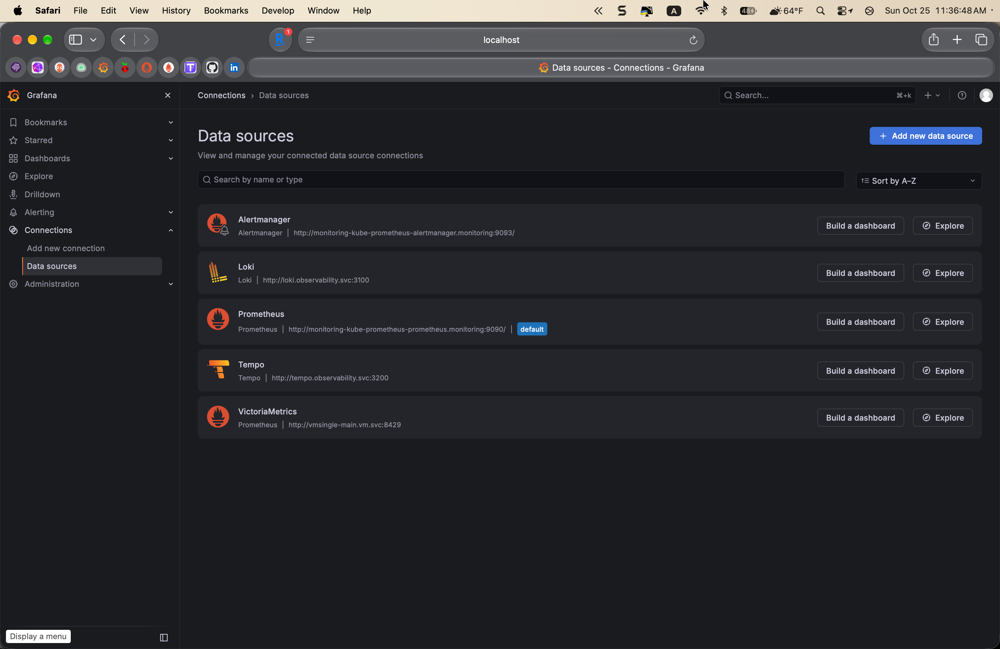
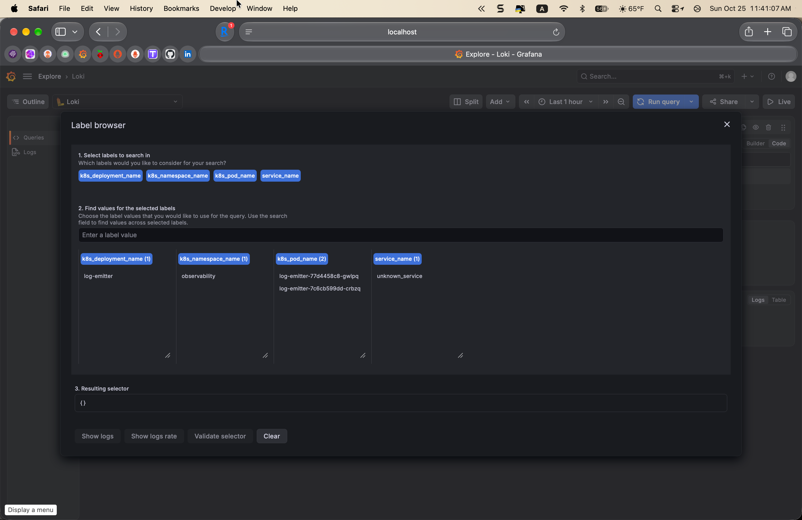
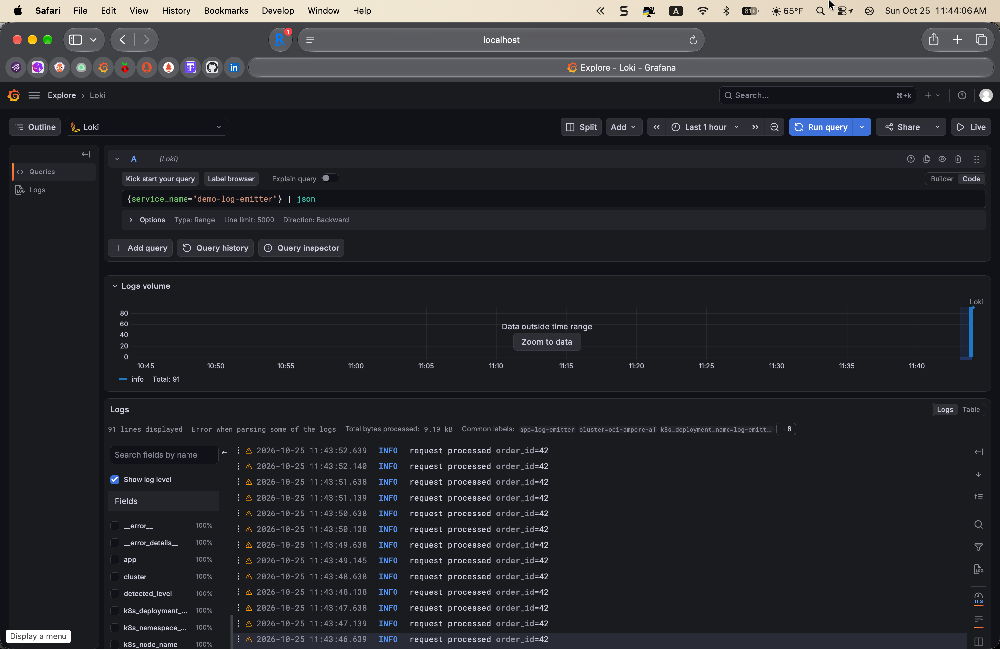
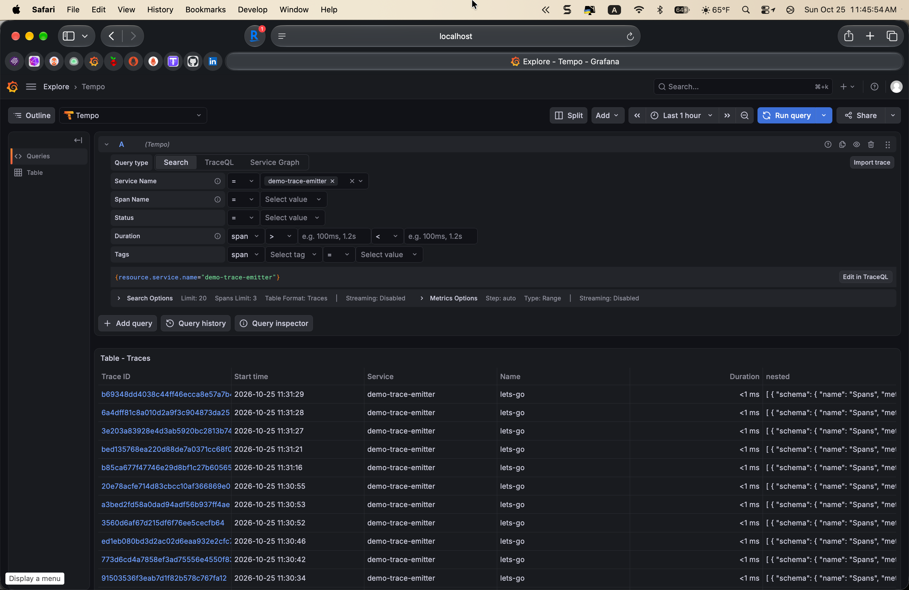
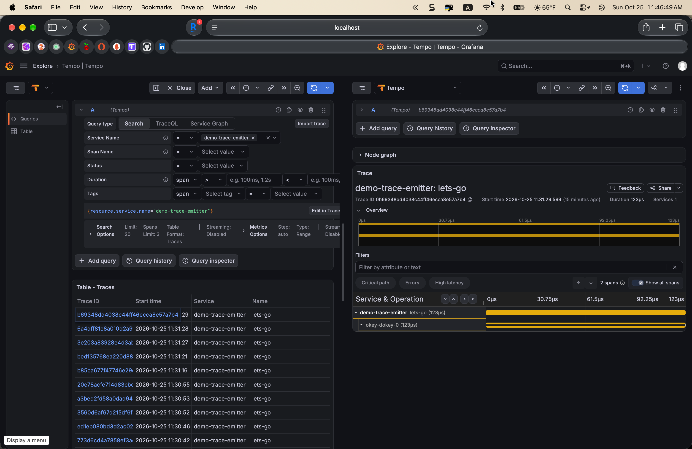
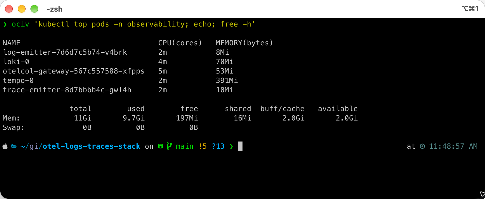

# otel-logs-traces-stack

[](https://github.com/bibigon14/otel-logs-traces-stack/actions/workflows/validate.yml)

Logs and traces half of the observability triad, dropped onto the same
Oracle Cloud Ampere A1 free-tier VM that already runs Prometheus and
VictoriaMetrics for metrics (see [vm-observability](https://github.com/bibigon14/vm-observability)).
The result is one Grafana pane with metrics, logs and traces all
pointing at the same timestamp and the same pod, built from three
upstream pieces glued together:

- **Grafana Loki 3.3.2** - log aggregation, 7d retention on local PVC
- **Grafana Tempo 2.6.1** - trace storage, 72h retention on local PVC
- **OpenTelemetry Collector 0.113.0** - gateway Deployment with
  OTLP in, Loki + Tempo + Prometheus-remote-write out



## Why this project

Every observability demo online uses `docker-compose up` and three sample
services. This one runs on a real multi-tenant single-node k3s cluster
alongside two production-shape metric stacks, a Kafka cluster with a
JVM producer/consumer workload, Cilium with Hubble L7, and an eBPF
TCP agent. The resource budget is honest, the scrape surface is real,
and the correlation story is the point - the demo isn't "it works",
the demo is "when the Kafka consumer lag SLO burns, you click the
alert, land in Grafana, and already have the trace span and the error
log line waiting."

## What's live (v0.1, shipped 2026-10-25)

### End-to-end pipeline

OTEL Collector receives OTLP from the demo workload, enriches every
record with Kubernetes metadata (pod/namespace/node/deployment via the
`k8sattributes` processor), and fans out to three backends. In Loki,
the enrichment shows up as proper labels you can query by:



The payoff is being able to query logs by Kubernetes identity rather
than by filename or container id:



Traces land in Tempo with the same resource attributes, so TraceQL
queries by `service.name` just work:



Clicking any trace opens the waterfall with parent and child spans
rendered against a timeline:



### Resource budget

On the shared 2 OCPU / 12 GiB OCI Ampere A1, the entire stack costs
**532 MiB RSS** (loki 70 + tempo 391 + otelcol 53 + two emitters 18),
leaving 2.0 GiB available alongside kube-prometheus-stack, VictoriaMetrics,
Strimzi Kafka, Cilium, and the eBPF observer:



Full breakdown and tuning notes in [docs/resource-budget.md](docs/resource-budget.md).

## What's deliberately out of scope for v0.1

- **Loki in simple-scalable or microservices mode** - single-binary is
  fine for a 2 OCPU / 12 GiB host and the migration path is well
  documented upstream; v0.3 if the cardinality ever justifies it
- **Tempo metrics generator** - would need Prometheus remote-write
  back into the metric stack, planned for v0.2 along with the
  tracesToMetrics span-rate dashboards
- **Object storage backend** (S3 / R2) - keeps the repo self-contained;
  file backend is the right default for a home-scale deployment
- **Grafana Alloy DaemonSet for pod stdout** - telemetrygen already
  provides OTLP traffic, so Alloy is unnecessary for v0.1; adds in v0.2
  for cluster-wide log collection
- **Log retention tiering** - 7 days is enough for a demo; a real
  production setup would push to S3 and compact

## Architecture

See [docs/architecture.md](docs/architecture.md) for the full topology
diagram, the OTEL pipeline shape, and the correlation story.

## Install

```bash
# Create the namespace + core workloads
kubectl apply -f manifests/00-namespace.yaml
kubectl apply -f manifests/loki/
kubectl apply -f manifests/tempo/
kubectl apply -f manifests/otel-collector/
kubectl apply -f manifests/grafana/
kubectl apply -f manifests/demo/

# Restart Grafana so the sidecar picks up the two new datasource ConfigMaps
kubectl -n monitoring rollout restart deployment monitoring-grafana

# Expose Grafana
kubectl -n monitoring port-forward svc/monitoring-grafana 3000:80
```

Open `http://localhost:3000`, go to Explore, pick the `Loki` or `Tempo`
datasource and query by `{k8s_namespace_name="observability"}`.

## Related

- [vm-observability](https://github.com/bibigon14/vm-observability) - metrics half of the triad
- [kafka-slo-observability](https://github.com/bibigon14/kafka-slo-observability) - the workload we're correlating against
- [cilium-l7-observability](https://github.com/bibigon14/cilium-l7-observability) - L7 flow data on the same cluster
